# Taller — JOINs, Funciones de Agregación y GROUP BY en PostgreSQL

**Asignatura:** Bases de Datos I - 2026-2  
**Programa:** Ingeniería de Sistemas  
**Universidad:** Universidad de Pamplona  
**Base de Datos:** `coffee_coop_db`  

---

## Parte A: INNER JOIN

### Ejercicio 1. Cruzando información básica

#### Literal a) Municipios de Norte de Santander

```sql
-- Exercise 01 - a
-- Municipalities: municipality code, municipality name, and department name for municipalities in Norte de Santander (department code 54)

SELECT 
    T1.municipality_code,
    T1.municipality_name AS municipality,
    T2.department_name AS department
FROM geo.municipalities T1
INNER JOIN geo.departments T2 
    ON T1.department_code = T2.department_code
WHERE T1.department_code = '54'
ORDER BY T1.municipality_name;
```

**Evidencia de ejecución:**  
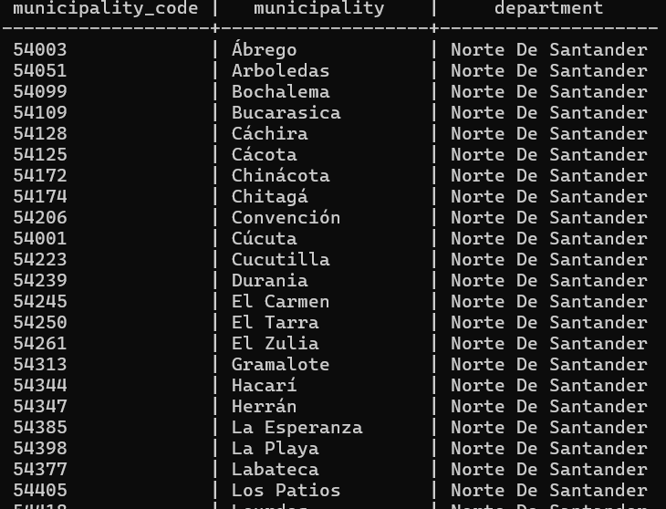

---

#### Literal b) Fincas y productores del municipio 54518

```sql
-- Exercise 01 - b
-- Farms: farm name, rural district, municipality name, first name, and last name for farms in municipality code 54518, ordered by farmer last name

SELECT 
    T1.farm_name AS farm,
    T1.rural_district,
    T2.municipality_name AS municipality,
    T3.first_name,
    T3.last_name
FROM farm.farms T1
INNER JOIN geo.municipalities T2 
    ON T1.municipality_code = T2.municipality_code
INNER JOIN farm.farmers T3 
    ON T1.farmer_id = T3.farmer_id
WHERE T1.municipality_code = '54518'
ORDER BY T3.last_name;
```

**Evidencia de ejecución:**  
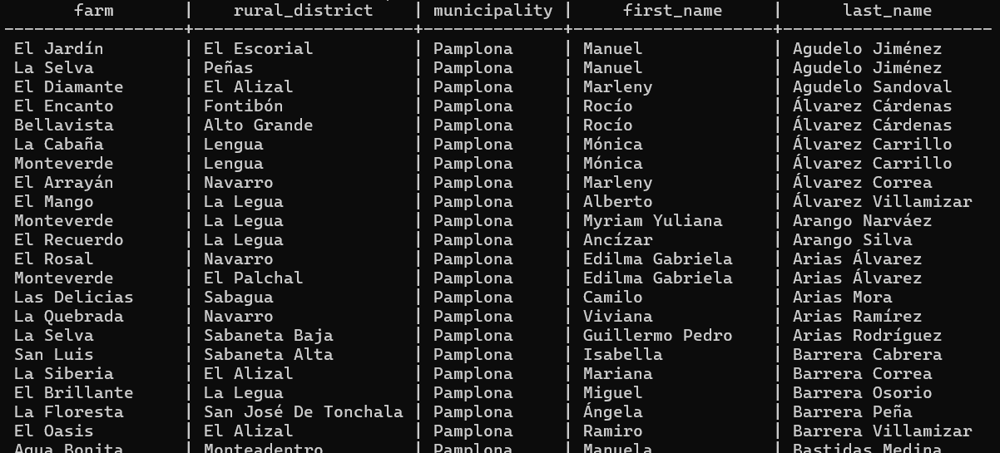

---

#### Literal c) Entregas del 30 de septiembre de 2026

```sql
-- Exercise 01 - c
-- Deliveries: delivery code, farm name, collection point name, and gross weight kg for deliveries on September 30, 2026, ordered by collection point and gross weight descending

SELECT 
    T1.delivery_id AS delivery,
    T2.farm_name AS farm,
    T3.point_name AS collection_point,
    T1.gross_weight_kg
FROM buy.deliveries T1
INNER JOIN farm.farms T2 
    ON T1.farm_id = T2.farm_id
INNER JOIN buy.collection_points T3 
    ON T1.collection_point_id = T3.collection_point_id
WHERE T1.delivery_id LIKE '%20260930%'
ORDER BY T3.point_name ASC, T1.gross_weight_kg DESC;
```

**Evidencia de ejecución:**  
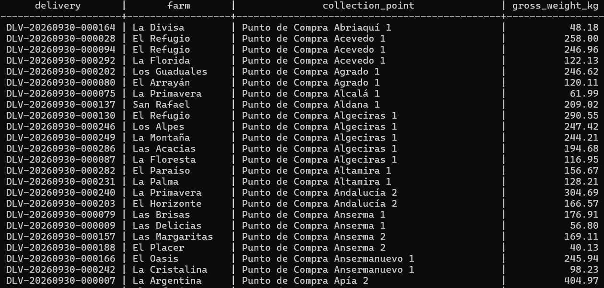

---

## Parte B: LEFT JOIN y RIGHT JOIN

### Ejercicio 2. `LEFT JOIN` - Encontrando registros sin correspondencia

#### Literal a) Todos los asociados del municipio 54518

```sql
-- Exercise 02 - a
-- Farmers: document number, first name, last name, and farm name for all farmers in municipality code 54518, including those without registered farms using LEFT JOIN

SELECT 
    T1.document_number AS document,
    T1.first_name,
    T1.last_name,
    T2.farm_name AS farm
FROM farm.farmers T1
LEFT JOIN farm.farms T2 
    ON T1.farmer_id = T2.farmer_id
WHERE T1.municipality_code = '54518';
```

**Evidencia de ejecución:**  
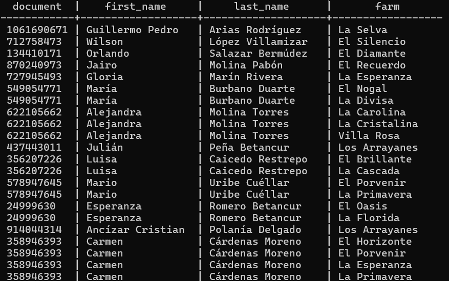

---

#### Literal b) Asociados sin fincas registradas

```sql
-- Exercise 02 - b
-- Farmers: document number, first name, and last name for farmers in municipality code 54518 who do not have any registered farm using LEFT JOIN and IS NULL

SELECT 
    T1.document_number AS document,
    T1.first_name,
    T1.last_name,
    T2.farm_name AS farm
FROM farm.farmers T1
LEFT JOIN farm.farms T2 
    ON T1.farmer_id = T2.farmer_id
WHERE T1.municipality_code = '54518' 
  AND T2.farm_id IS NULL;
```

**Evidencia de ejecución:**  
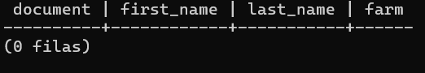

---

#### Literal c) Entregas con y sin análisis de calidad

```sql
-- Exercise 02 - c
-- Deliveries: delivery code, analysis code, and cup score for all deliveries on September 30, 2026, including those without quality analysis using LEFT JOIN, ordered by delivery code

SELECT 
    T1.delivery_id AS delivery,
    T2.analysis_id AS analysis,
    T2.cup_score
FROM buy.deliveries T1
LEFT JOIN buy.quality_analyses T2 
    ON T1.delivery_id = T2.delivery_id
WHERE T1.delivery_id LIKE '%20260930%'
ORDER BY T1.delivery_id;
```

**Evidencia de ejecución:**  
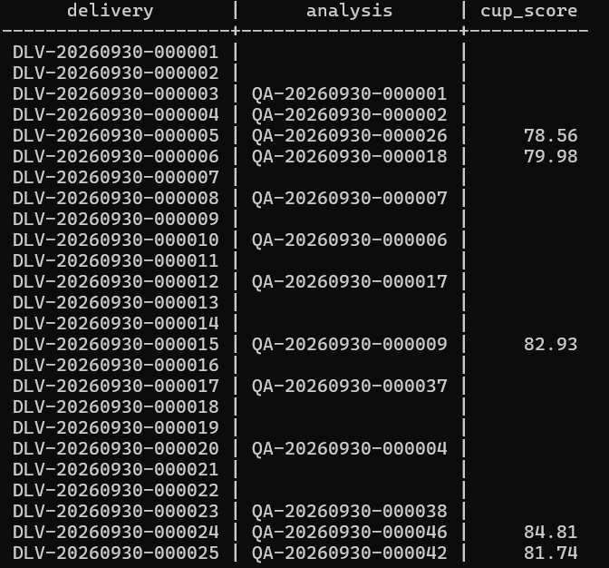

---

### Ejercicio 3. `RIGHT JOIN` - El enfoque inverso

#### Literal a) Puntos de compra con y sin entregas

```sql
-- Exercise 03 - a
-- Collection points: collection point name, delivery code, and gross weight kg for all collection points on September 30, 2026, including points with no deliveries using RIGHT JOIN

SELECT 
    T2.point_name AS collection_point,
    T1.delivery_id AS delivery,
    T1.gross_weight_kg
FROM buy.deliveries T1
RIGHT JOIN buy.collection_points T2 
    ON T1.collection_point_id = T2.collection_point_id
   AND T1.delivery_id LIKE '%20260930%';
```

**Evidencia de ejecución:**  
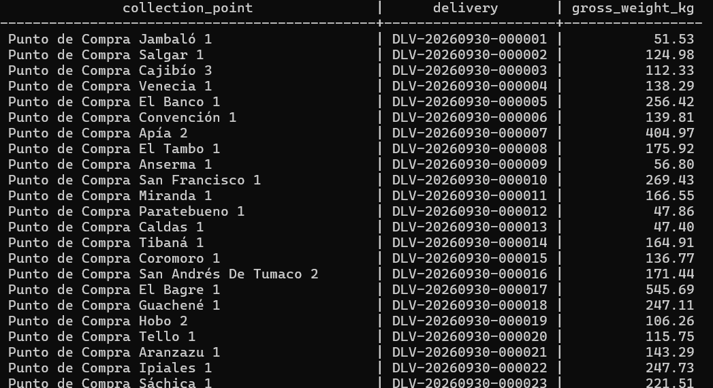

**Análisis (Literal 3 a):**  
En esta consulta se utiliza la condición de fecha dentro del `ON` del `RIGHT JOIN` para preservar la inclusión de todos los puntos de compra de la tabla derecha (`buy.collection_points`), registren o no entregas el 30 de septiembre de 2026; si dicha condición se ubicara en la cláusula `WHERE`, evaluaría las entregas no encontradas como nulas (`NULL`), eliminándolas del resultado y transformando lógicamente la consulta en un `INNER JOIN` que ocultaría los puntos sin actividad ese día.

---

#### Literal b) Puntos de compra inactivos el 30 de septiembre de 2026

```sql
-- Exercise 03 - b
-- Collection points: collection point name for collection points that received no deliveries on September 30, 2026 using RIGHT JOIN and IS NULL

SELECT 
    T2.point_name AS collection_point,
    T1.delivery_id AS delivery,
    T1.gross_weight_kg
FROM buy.deliveries T1
RIGHT JOIN buy.collection_points T2 
    ON T1.collection_point_id = T2.collection_point_id
   AND T1.delivery_id LIKE '%20260930%'
WHERE T1.delivery_id IS NULL;
```

**Evidencia de ejecución:**  
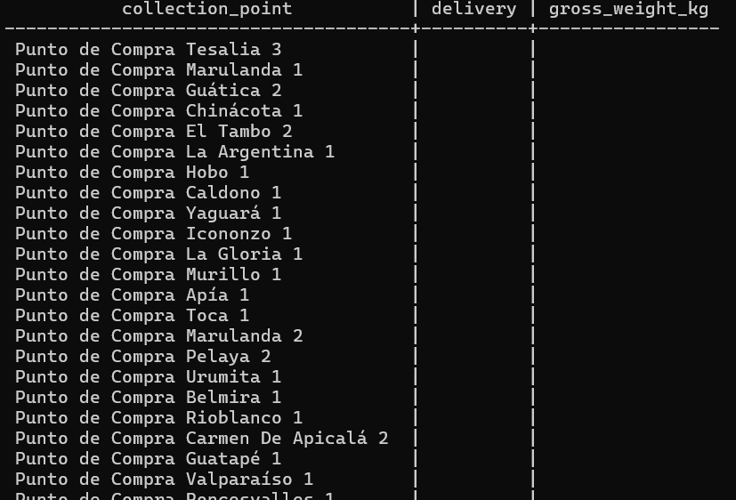

---

#### Literal c) Variedades de café sin sembrar

```sql
-- Exercise 03 - c
-- Coffee varieties: variety name and species for coffee varieties that are not planted in any plot using RIGHT JOIN and IS NULL

SELECT 
    T2.variety_name AS variety,
    T2.species
FROM farm.plot_varieties T1
RIGHT JOIN farm.coffee_varieties T2 
    ON T1.variety_id = T2.variety_id
WHERE T1.variety_id IS NULL;
```

**Evidencia de ejecución:**  
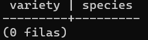

---

## Parte C: Funciones de Agregación y GROUP BY

### Ejercicio 7. Agrupación básica

#### Literal a) Resumen total de entregas

```sql
-- Exercise 07 - a
-- Summary of deliveries on September 30, 2026: total deliveries, sum of gross weight, average gross weight, and distinct farms delivering

SELECT 
    COUNT(T1.delivery_id) AS total_deliveries,
    SUM(T1.gross_weight_kg) AS total_gross_kg,
    ROUND(AVG(T1.gross_weight_kg), 2) AS avg_gross_kg,
    COUNT(DISTINCT T1.farm_id) AS farms_delivering
FROM buy.deliveries T1
WHERE T1.delivery_id LIKE '%20260930%';
```

**Evidencia de ejecución:**  
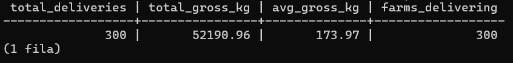

---

#### Literal b) Resumen de análisis de calidad

```sql
-- Exercise 07 - b
-- Summary of quality analyses on September 30, 2026: min, max, and avg cup score, min and max moisture percentage

SELECT 
    MIN(T1.cup_score) AS min_cup_score,
    MAX(T1.cup_score) AS max_cup_score,
    ROUND(AVG(T1.cup_score), 2) AS avg_cup_score,
    MIN(T1.moisture_pct) AS min_moisture_pct,
    MAX(T1.moisture_pct) AS max_moisture_pct
FROM buy.quality_analyses T1
WHERE T1.delivery_id LIKE '%20260930%';
```

**Evidencia de ejecución:**  
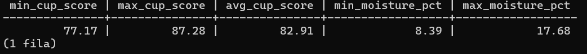

---

#### Literal c) Conteo de productores con correo

```sql
-- Exercise 07 - c
-- Summary of farmers in municipality code 54518: total farmers count and total farmers with email count

SELECT 
    COUNT(*) AS total_farmers,
    COUNT(T1.email) AS farmers_with_email
FROM farm.farmers T1
WHERE T1.municipality_code = '54518';
```

**Evidencia de ejecución:**  
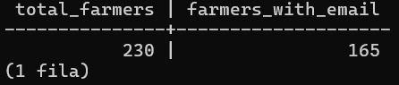

**Análisis (Literal 7 c):**  
El primer conteo usa asterisco y cuenta todas las personas guardadas en la lista, mientras que el segundo conteo mira la casilla del correo, salta a quienes la tienen vacía y por eso da un número más pequeño.

---

### Ejercicio 8. `GROUP BY` - Agrupando resultados

#### Literal a) Municipios por departamento

```sql
-- Exercise 08 - a
-- Departments: department name and count of municipalities per department, ordered by municipalities count descending

SELECT 
    T1.department_name AS department,
    COUNT(T2.municipality_code) AS municipalities_count
FROM geo.departments T1
INNER JOIN geo.municipalities T2 
    ON T1.department_code = T2.department_code
GROUP BY T1.department_name
ORDER BY municipalities_count DESC;
```

**Evidencia de ejecución:**  
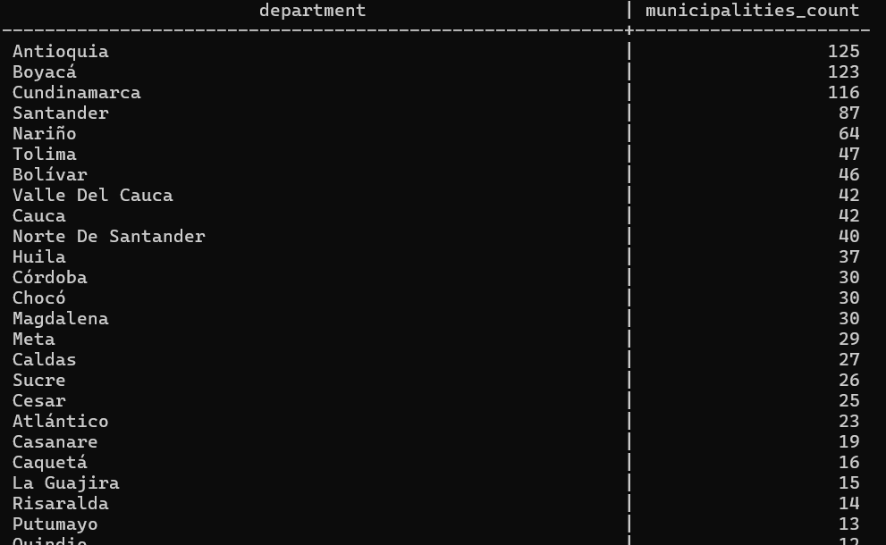

---

#### Literal b) Entregas por tipo de café

```sql
-- Exercise 08 - b
-- Deliveries summary on September 30, 2026: count of deliveries and total gross weight by coffee type, ordered by total gross weight descending

SELECT 
    T1.coffee_type,
    COUNT(T1.delivery_id) AS deliveries_count,
    SUM(T1.gross_weight_kg) AS total_gross_kg
FROM buy.deliveries T1
WHERE T1.delivery_id LIKE '%20260930%'
GROUP BY T1.coffee_type
ORDER BY total_gross_kg DESC;
```

**Evidencia de ejecución:**  
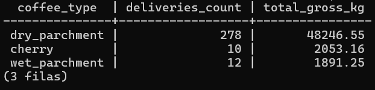

---

#### Literal c) Entregas por punto de compra

```sql
-- Exercise 08 - c
-- Deliveries summary on September 30, 2026: count of deliveries, total gross weight, and average gross weight by collection point name

SELECT 
    T2.point_name AS collection_point,
    COUNT(T1.delivery_id) AS deliveries_count,
    SUM(T1.gross_weight_kg) AS total_gross_kg,
    ROUND(AVG(T1.gross_weight_kg), 2) AS avg_gross_kg
FROM buy.deliveries T1
INNER JOIN buy.collection_points T2 
    ON T1.collection_point_id = T2.collection_point_id
WHERE T1.delivery_id LIKE '%20260930%'
GROUP BY T2.point_name;
```

**Evidencia de ejecución:**  
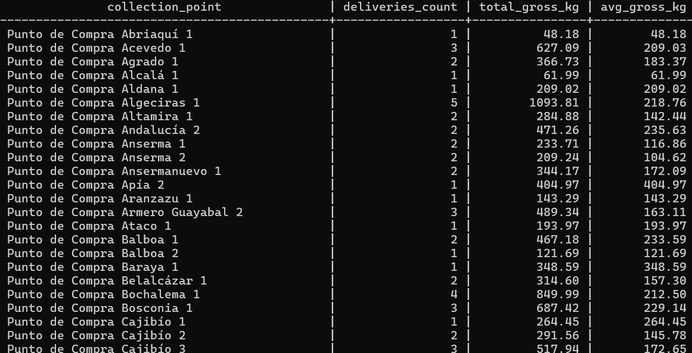

---

### Ejercicio 9. `HAVING` - Filtrando grupos

#### Literal a) Departamentos con más de 40 municipios

```sql
-- Exercise 09 - a
-- Departments: department name and count of municipalities for departments with more than 40 municipalities using HAVING, ordered by count descending

SELECT 
    T1.department_name AS department,
    COUNT(T2.municipality_code) AS municipalities_count
FROM geo.departments T1
INNER JOIN geo.municipalities T2 
    ON T1.department_code = T2.department_code
GROUP BY T1.department_name
HAVING COUNT(T2.municipality_code) > 40
ORDER BY municipalities_count DESC;
```

**Evidencia de ejecución:**  
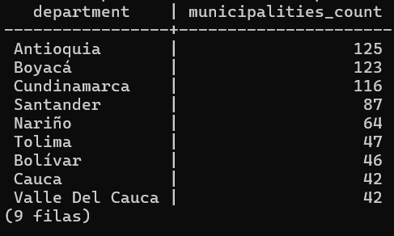

---

#### Literal b) Puntos de compra con acopio superior a 1000 kg

```sql
-- Exercise 09 - b
-- Collection points: collection point name and total gross weight for collection points that received more than 1000 kg on September 30, 2026 using HAVING, ordered by total gross weight descending

SELECT 
    T2.point_name AS collection_point,
    SUM(T1.gross_weight_kg) AS total_gross_kg
FROM buy.deliveries T1
INNER JOIN buy.collection_points T2 
    ON T1.collection_point_id = T2.collection_point_id
WHERE T1.delivery_id LIKE '%20260930%'
GROUP BY T2.point_name
HAVING SUM(T1.gross_weight_kg) > 1000
ORDER BY total_gross_kg DESC;
```

**Evidencia de ejecución:**  
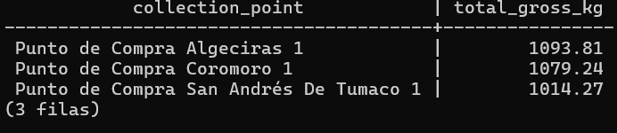

---

#### Literal c) Fincas de alta calidad

```sql
-- Exercise 09 - c
-- Farms: farm name, analyses count, and average cup score for farms with at least 3 quality analyses and average cup score of 84 or higher using HAVING across 3 tables, ordered by average score descending

SELECT 
    T1.farm_name AS farm,
    COUNT(T3.analysis_id) AS analyses_count,
    ROUND(AVG(T3.cup_score), 2) AS avg_cup_score
FROM farm.farms T1
INNER JOIN buy.deliveries T2 
    ON T1.farm_id = T2.farm_id
INNER JOIN buy.quality_analyses T3 
    ON T2.delivery_id = T3.delivery_id
GROUP BY T1.farm_name
HAVING COUNT(T3.analysis_id) >= 3 
   AND AVG(T3.cup_score) >= 84
ORDER BY avg_cup_score DESC;
```

**Evidencia de ejecución:**  
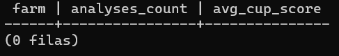

---

## Parte D: Ejercicios Integradores

### Ejercicio 10. `JOIN`, `GROUP BY` y `HAVING` Avanzados

#### Literal a) Liquidaciones por asociado (4 tablas)

```sql
-- Exercise 10 - a
-- Farmers summary for September 2026: document, first name, last name, settlements count, and total net amount, ordered by total net amount descending (4 tables)

SELECT 
    T4.document_number AS document,
    T4.first_name,
    T4.last_name,
    COUNT(T1.settlement_id) AS settlements_count,
    SUM(T1.net_amount) AS total_net_cop
FROM pay.settlements T1
INNER JOIN buy.deliveries T2 
    ON T1.delivery_id = T2.delivery_id
INNER JOIN farm.farms T3 
    ON T2.farm_id = T3.farm_id
INNER JOIN farm.farmers T4 
    ON T3.farmer_id = T4.farmer_id
WHERE CAST(T1.settled_at AS TEXT) LIKE '%2026-09%'
GROUP BY T4.document_number, T4.first_name, T4.last_name
ORDER BY total_net_cop DESC;
```

**Evidencia de ejecución:**  
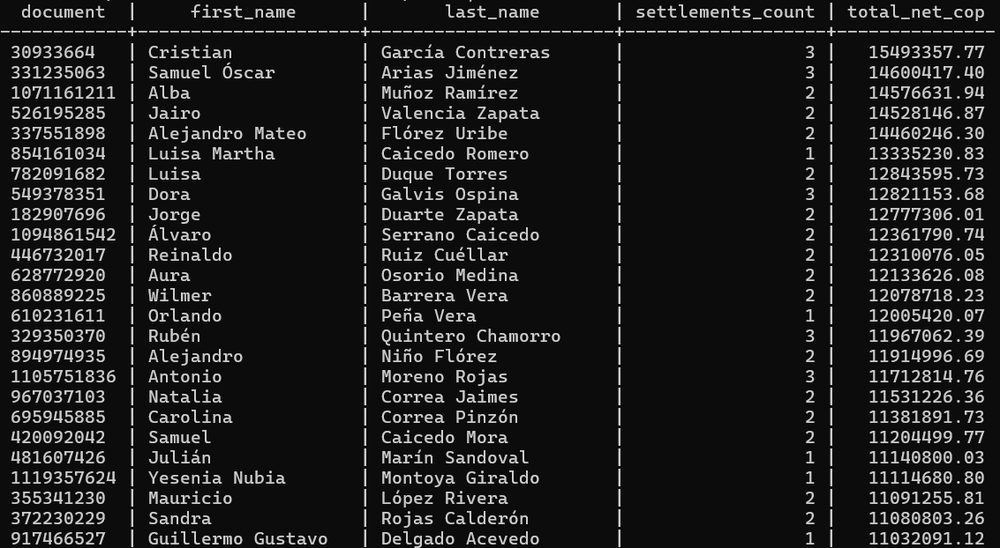

---

#### Literal b) Asociados con más de $5,000,000 en liquidaciones

```sql
-- Exercise 10 - b
-- Farmers summary for September 2026 with total net amount greater than 5,000,000 using HAVING, ordered by total net amount descending (4 tables)

SELECT 
    T4.document_number AS document,
    T4.first_name,
    T4.last_name,
    COUNT(T1.settlement_id) AS settlements_count,
    SUM(T1.net_amount) AS total_net_cop
FROM pay.settlements T1
INNER JOIN buy.deliveries T2 
    ON T1.delivery_id = T2.delivery_id
INNER JOIN farm.farms T3 
    ON T2.farm_id = T3.farm_id
INNER JOIN farm.farmers T4 
    ON T3.farmer_id = T4.farmer_id
WHERE CAST(T1.settled_at AS TEXT) LIKE '%2026-09%'
GROUP BY T4.document_number, T4.first_name, T4.last_name
HAVING SUM(T1.net_amount) > 5000000
ORDER BY total_net_cop DESC;
```

**Evidencia de ejecución:**  
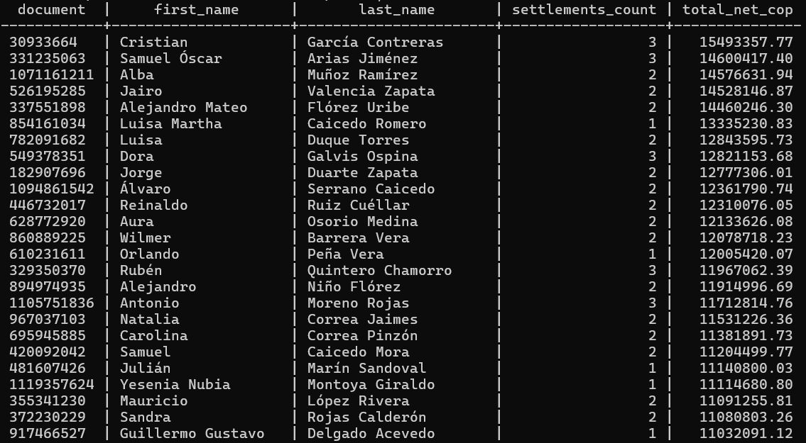


---

#### Literal c) Resumen de fincas por municipio en Norte de Santander

```sql
-- Exercise 10 - c
-- Municipalities summary in Norte de Santander: municipality name, farms count, total area ha, and average altitude masl (rounded to 2 decimals) for municipalities with at least 5 farms using HAVING, ordered by average altitude descending

SELECT 
    T1.municipality_name AS municipality,
    COUNT(T2.farm_id) AS farms_count,
    SUM(T2.total_area_ha) AS total_area_ha,
    ROUND(AVG(T2.altitude_masl), 2) AS avg_altitude_masl
FROM geo.municipalities T1
INNER JOIN farm.farms T2 
    ON T1.municipality_code = T2.municipality_code
WHERE T1.department_code = '54'
GROUP BY T1.municipality_name
HAVING COUNT(T2.farm_id) >= 5
ORDER BY avg_altitude_masl DESC;
```

**Evidencia de ejecución:**  
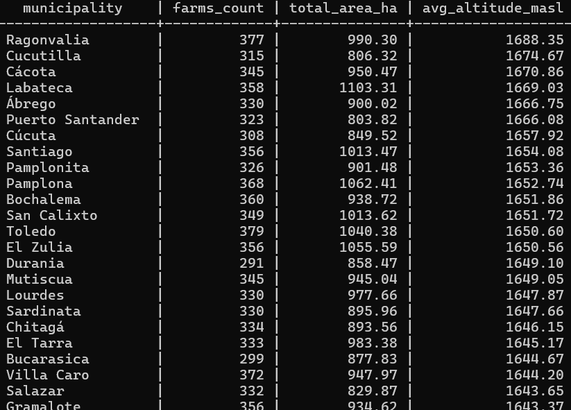


**Análisis (Literal 10 c):**  
El código del departamento va en el `WHERE` porque revisa y limpia los datos fila por fila antes de juntarlos, mientras que la cuenta de fincas va en el `HAVING` porque esa suma solo se puede revisar después de armar los grupos por municipio.