# Taller: Fechas, Cadenas, Operaciones de Conjunto y Funciones en PostgreSQL

**Asignatura:** Bases de Datos I - 2026-2  
**Programa:** Ingeniería de Sistemas  
**Universidad:** Universidad de Pamplona  
**Docente:** Prf. Juan Alejandro Carrillo Jaimes  
**Base de Datos:** `coffee_coop_db`  

---

## Parte A: Manejo de fechas

### Ejercicio 1. `CURRENT_DATE`, `NOW` y `AGE` - Antigüedad de los asociados

#### Literal a) Antigüedad en días a la fecha de hoy (municipio 54518)

```sql
-- Exercise 01 - a
-- Document, first name, last name, membership date, and membership days to CURRENT_DATE for farmers in municipality 54518

SELECT 
    T1.document_number AS document,
    T1.first_name,
    T1.last_name,
    T1.membership_date,
    (CURRENT_DATE - T1.membership_date) AS membership_days
FROM farm.farmers T1
WHERE T1.municipality_code = '54518'
ORDER BY membership_days DESC;
```

**Evidencia de ejecución:**  
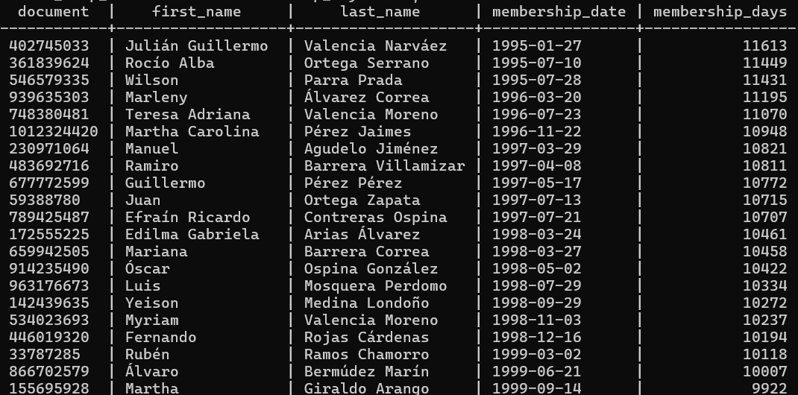

---

#### Literal b) Top 10 asociados más antiguos al 30 de septiembre de 2026

```sql
-- Exercise 01 - b
-- Top 10 oldest farmers in municipality 54518 with age and years of membership as of 2026-09-30

SELECT 
    T1.document_number AS document,
    T1.first_name,
    T1.last_name,
    AGE(DATE '2026-09-30', T1.membership_date) AS membership_age,
    DATE_PART('year', AGE(DATE '2026-09-30', T1.membership_date)) AS membership_years
FROM farm.farmers T1
WHERE T1.municipality_code = '54518'
ORDER BY T1.membership_date
LIMIT 10;
```

**Evidencia de ejecución:**  
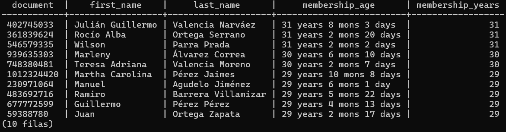

---

#### Literal c) Fecha y hora actual del sistema (`NOW()` y `CURRENT_DATE`)

```sql
-- Exercise 01 - c
-- Current timestamp and current date in a single row without table

SELECT 
    NOW() AS now_ts,
    CURRENT_DATE AS today;
```

**Evidencia de ejecución:**  
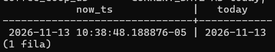

#### Análisis y explicación (Ejercicio 1):
La función `NOW()` devuelve tanto la fecha como la hora exacta con precisión de microsegundos y zona horaria del servidor, mientras que `CURRENT_DATE` retorna únicamente la fecha del calendario sin componente horario; debido a esto, el resultado del literal a) cambia dinámicamente cada día al restar la fecha de afiliación contra la fecha actual del sistema, mientras que el literal b) permanece siempre estático e invariable porque utiliza una fecha de corte fija (`2026-09-30`) como referencia de cálculo.

---

### Ejercicio 2. `DATE_PART` y `GROUP BY` - Edad de los asociados

#### Literal a) Top 10 asociados de mayor edad del municipio 54518

```sql
-- Exercise 02 - a
-- Top 10 oldest farmers of Pamplona (54518), age at 2026-09-30

SELECT 
    T1.first_name,
    T1.last_name,
    T1.birth_date,
    DATE_PART('year', AGE(DATE '2026-09-30', T1.birth_date)) AS age_years
FROM farm.farmers T1
WHERE T1.municipality_code = '54518'
ORDER BY T1.birth_date
LIMIT 10;
```

**Evidencia de ejecución:**  
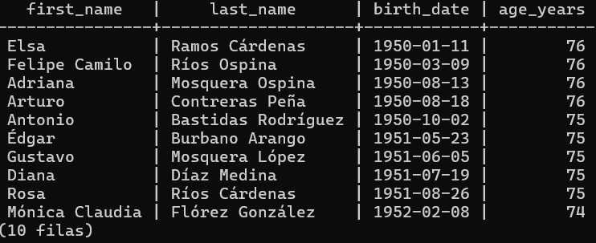

---

#### Literal b) Conteo y edad promedio por género (municipio 54518)

```sql
-- Exercise 02 - b
-- Farmers count and average age in years by gender in municipality 54518 as of 2026-09-30

SELECT 
    T1.gender,
    COUNT(T1.farmer_id) AS farmers_count,
    ROUND(AVG(DATE_PART('year', AGE(DATE '2026-09-30', T1.birth_date)))::NUMERIC, 2) AS avg_age_years
FROM farm.farmers T1
WHERE T1.municipality_code = '54518'
GROUP BY T1.gender;
```

**Evidencia de ejecución:**  
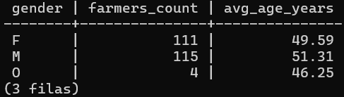

---

#### Literal c) Municipios de Norte de Santander con edad promedio superior a 51 años

```sql
-- Exercise 02 - c
-- Municipalities in Norte de Santander with average farmer age greater than 51 years as of 2026-09-30

SELECT 
    T2.municipality_name AS municipality,
    COUNT(T1.farmer_id) AS farmers_count,
    ROUND(AVG(DATE_PART('year', AGE(DATE '2026-09-30', T1.birth_date)))::NUMERIC, 2) AS avg_age_years
FROM farm.farmers T1
INNER JOIN geo.municipalities T2 
    ON T1.municipality_code = T2.municipality_code
WHERE T2.department_code = '54'
GROUP BY T2.municipality_name
HAVING AVG(DATE_PART('year', AGE(DATE '2026-09-30', T1.birth_date))) > 51
ORDER BY municipality;
```

**Evidencia de ejecución:**  
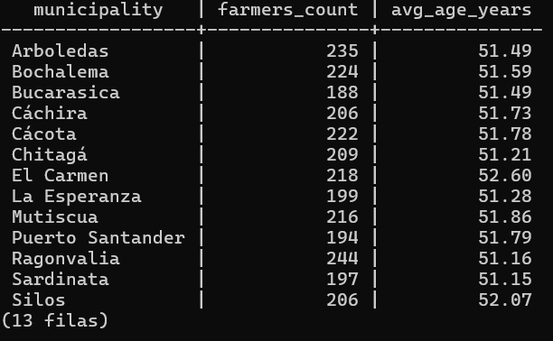

---

### Ejercicio 3. `EXTRACT` - El calendario de las entregas

#### Literal a) Entregas por día de la semana en septiembre de 2026

```sql
-- Exercise 03 - a
-- Deliveries in September 2026: day of week, deliveries count, and total gross weight, ordered by day of week

SELECT 
    EXTRACT(dow FROM T1.delivered_at) AS day_of_week,
    COUNT(T1.delivery_id) AS deliveries_count,
    SUM(T1.gross_weight_kg) AS total_gross_kg
FROM buy.deliveries T1
WHERE EXTRACT(year FROM T1.delivered_at) = 2026 
  AND EXTRACT(month FROM T1.delivered_at) = 9
GROUP BY EXTRACT(dow FROM T1.delivered_at)
ORDER BY day_of_week;
```

**Evidencia de ejecución:**  
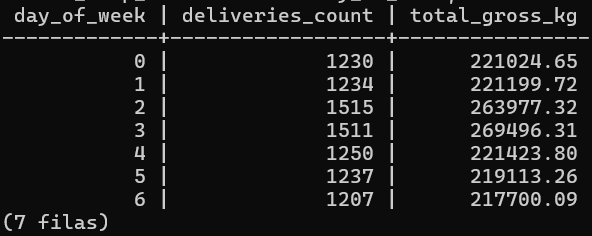

---

#### Literal b) Entregas por mes en 2026

```sql
-- Exercise 03 - b
-- Deliveries in 2026: month number, count of deliveries, and total gross weight, ordered by month using EXTRACT

SELECT 
    EXTRACT(month FROM T1.delivered_at) AS month_number,
    COUNT(T1.delivery_id) AS deliveries_count,
    SUM(T1.gross_weight_kg) AS total_gross_kg
FROM buy.deliveries T1
WHERE EXTRACT(year FROM T1.delivered_at) = 2026
GROUP BY EXTRACT(month FROM T1.delivered_at)
ORDER BY month_number;
```

**Evidencia de ejecución:**  
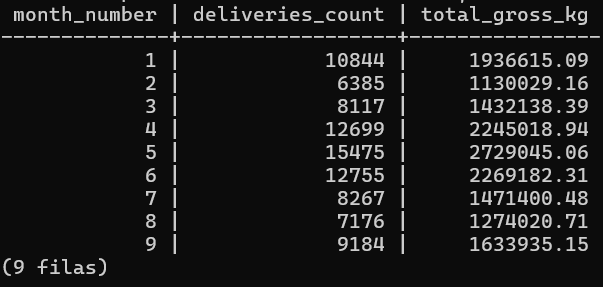

#### Análisis de cosechas (Literal 3 b):
Los meses con mayor acopio de café son mayo (15 475 entregas y 2 729 045.06 kg), junio (12 755 entregas) y abril (12 699 entregas), lo cual coincide con la cosecha principal de mitad de año en la región andina colombiana, mientras que enero (10 844 entregas) y septiembre (9 184 entregas) reflejan los picos de la cosecha mitaca o de traviesa.

---

#### Literal c) Top 10 entregas con mayor tiempo de análisis el 30 de septiembre de 2026

```sql
-- Exercise 03 - c
-- Top 10 deliveries on September 30, 2026 with the longest hours between reception and quality analysis

SELECT 
    T1.delivery_id AS delivery,
    T1.delivered_at,
    T2.analyzed_at,
    ROUND((EXTRACT(epoch FROM (T2.analyzed_at - T1.delivered_at)) / 3600)::NUMERIC, 2) AS hours_to_analysis
FROM buy.deliveries T1
INNER JOIN buy.quality_analyses T2 
    ON T1.delivery_id = T2.delivery_id
WHERE T1.delivery_id LIKE '%20260930%'
ORDER BY hours_to_analysis DESC
LIMIT 10;
```

**Evidencia de ejecución:**  
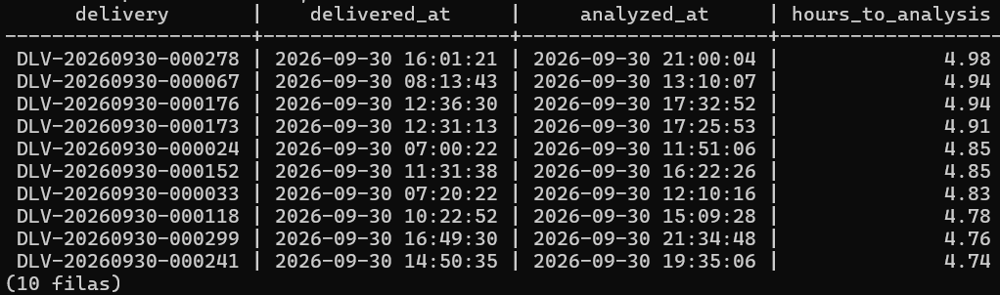

---

### Ejercicio 4. Fechas combinadas - Vigencia de las certificaciones

#### Literal a) Top 10 periodos de certificación cerrados de mayor duración (municipio 54518)

```sql
-- Exercise 04 - a
-- Top 10 closed certification periods with the longest duration for farms in municipality 54518

SELECT 
    T1.farm_name AS farm,
    T3.certification_name AS certification,
    T2.start_date,
    T2.end_date,
    (T2.end_date - T2.start_date) AS duration_days,
    AGE(T2.end_date, T2.start_date) AS duration
FROM farm.farms T1
INNER JOIN farm.farm_certifications T2 
    ON T1.farm_id = T2.farm_id
INNER JOIN farm.certifications T3 
    ON T2.certification_id = T3.certification_id
WHERE T1.municipality_code = '54518'
  AND T2.end_date IS NOT NULL
ORDER BY duration_days DESC
LIMIT 10;
```

**Evidencia de ejecución:**  
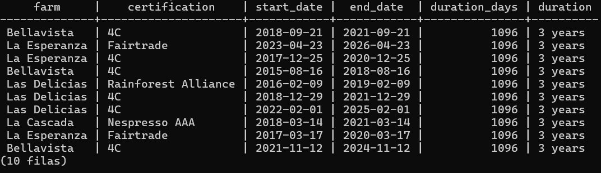

#### Observación sobre duración de certificados (Literal 4 a):
Se observa que todos los periodos de certificación cerrados tienen una duración exactamente idéntica de 1096 días, lo que equivale de forma uniforme a un periodo estándar de 3 años exactos para la vigencia de las normativas de calidad en las fincas.

---

#### Literal b) Certificaciones vigentes con 2 años o más al 30 de septiembre de 2026 (municipio 54518)

```sql
-- Exercise 04 - b
-- Active certifications (end_date IS NULL) with 2 or more years as of 2026-09-30 for farms in municipality 54518

SELECT 
    T1.farm_name AS farm,
    T3.certification_name AS certification,
    T2.start_date,
    DATE_PART('year', AGE(DATE '2026-09-30', T2.start_date)) AS years_active
FROM farm.farms T1
INNER JOIN farm.farm_certifications T2 
    ON T1.farm_id = T2.farm_id
INNER JOIN farm.certifications T3 
    ON T2.certification_id = T3.certification_id
WHERE T1.municipality_code = '54518'
  AND T2.end_date IS NULL
  AND DATE_PART('year', AGE(DATE '2026-09-30', T2.start_date)) >= 2
ORDER BY years_active DESC, farm ASC;
```

**Evidencia de ejecución:**  
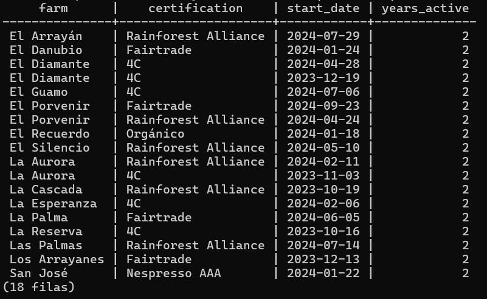

---

#### Literal c) Resumen de entregas por semana (semanas 36 a 40 de 2026)

```sql
-- Exercise 04 - c
-- Deliveries summary for weeks 36 to 40 in 2026: week number, deliveries count, first day of year (doy), and last day of year (doy)

SELECT 
    EXTRACT(week FROM T1.delivered_at) AS week_number,
    COUNT(T1.delivery_id) AS deliveries_count,
    MIN(EXTRACT(doy FROM T1.delivered_at)) AS first_day_of_year,
    MAX(EXTRACT(doy FROM T1.delivered_at)) AS last_day_of_year
FROM buy.deliveries T1
WHERE EXTRACT(year FROM T1.delivered_at) = 2026
  AND EXTRACT(week FROM T1.delivered_at) BETWEEN 36 AND 40
GROUP BY EXTRACT(week FROM T1.delivered_at)
ORDER BY week_number;
```

**Evidencia de ejecución:**  
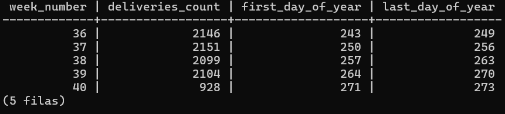

#### Explicación sobre la semana 40 (Literal 4 c):
La semana 40 registra un número significativamente menor de entregas (928) porque los datos del sistema cierran y llegan únicamente hasta el día 30 de septiembre, lo que abarca solo los primeros 3 días de dicha semana y trunca el conteo total en comparación con las semanas anteriores completas de 7 días.

---

## Parte B: Manejo de cadenas

### Ejercicio 5. `UPPER`, `LOWER` y `LENGTH` - Catálogos y búsquedas

#### Literal a) Catálogo de variedades de café formateado

```sql
-- Exercise 05 - a
-- Coffee varieties in uppercase, species in lowercase, and name length, ordered by length descending

SELECT 
    UPPER(T1.variety_name) AS variety_upper,
    LOWER(T1.species) AS species,
    LENGTH(T1.variety_name) AS name_length
FROM farm.coffee_varieties T1
ORDER BY name_length DESC, variety_upper ASC;
```

**Evidencia de ejecución:**  
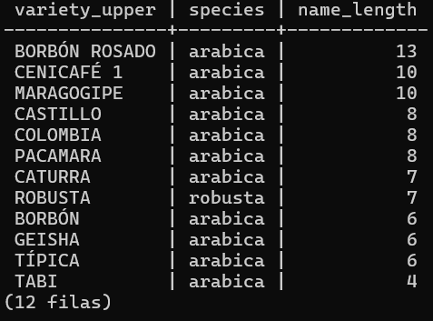

---

#### Literal b) Municipio de Norte de Santander con el nombre más largo

```sql
-- Exercise 05 - b
-- Municipality in Norte de Santander with the longest name and its length

SELECT 
    T1.municipality_name AS municipality,
    LENGTH(T1.municipality_name) AS name_length
FROM geo.municipalities T1
INNER JOIN geo.departments T2 
    ON T1.department_code = T2.department_code
WHERE UPPER(T2.department_name) = UPPER('Norte de Santander')
ORDER BY name_length DESC, municipality ASC
LIMIT 1;
```

**Evidencia de ejecución:**  
| municipality | name_length |
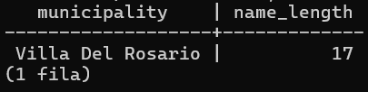

---

#### Literal c) Comparación exacta vs. función `UPPER` para `'Norte de Santander'`

```sql
-- Exercise 05 - c
-- Department code and name matching 'Norte de Santander' using exact string comparison vs UPPER function comparison

-- Query 1: Exact match
SELECT 
    T1.department_code AS code,
    T1.department_name AS department
FROM geo.departments T1
WHERE T1.department_name = 'Norte de Santander';

-- Query 2: UPPER function comparison
SELECT 
    T1.department_code AS code,
    T1.department_name AS department
FROM geo.departments T1
WHERE UPPER(T1.department_name) = UPPER('Norte de Santander');
```

**Evidencia de ejecución:**  
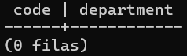
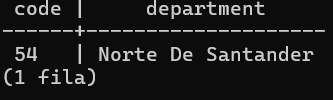

#### Explicación de la diferencia en los resultados (Literal 5 c):
La primera consulta no devuelve filas porque el texto almacenado en la base de datos contiene una letra mayúscula adicional en el conector (`Norte De Santander`), lo que genera una discrepancia estricta frente al texto literal proporcionado en el filtro, mientras que la segunda consulta sí es exitosa porque utiliza la función `UPPER` para convertir ambos textos a mayúsculas uniformes antes de compararlos, permitiendo así ignorar las diferencias de capitalización.

---

### Ejercicio 6. `CONCAT` y `SUBSTRING` - Armar y desarmar textos

#### Literal a) Nombre corto de asociadas del municipio 54518

```sql
-- Exercise 06 - a
-- Short name (initial in uppercase, dot, space, and last name) and phone for female farmers in municipality 54518

SELECT 
    CONCAT(UPPER(SUBSTRING(T1.first_name FROM 1 FOR 1)), '. ', T1.last_name) AS short_name,
    T1.phone_number AS phone
FROM farm.farmers T1
WHERE T1.municipality_code = '54518'
  AND T1.gender = 'F'
ORDER BY T1.last_name ASC, T1.first_name ASC;
```

**Evidencia de ejecución:**  
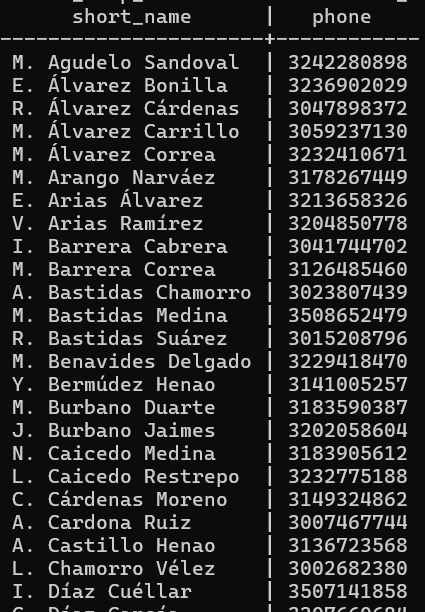

---

#### Literal b) Frase descriptiva por punto de compra en Norte de Santander

```sql
-- Exercise 06 - b
-- Description phrase for each collection point in Norte de Santander using CONCAT

SELECT 
    CONCAT(T1.point_name, ' recibe café en ', T2.municipality_name) AS description
FROM buy.collection_points T1
INNER JOIN geo.municipalities T2 
    ON T1.municipality_code = T2.municipality_code
WHERE T2.department_code = '54'
ORDER BY T1.point_name;
```

**Evidencia de ejecución:**  
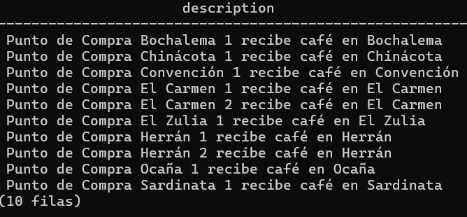

---

#### Literal c) Desglose de códigos de entrega en el Punto de Compra Bochalema 1 (ID 163)

```sql
-- Exercise 06 - c
-- Full delivery code, prefix, date code, sequence code, and timestamp for deliveries at collection point 163 on September 30, 2026

SELECT 
    T1.delivery_id AS delivery,
    SUBSTRING(T1.delivery_id FROM 1 FOR 3) AS prefix,
    SUBSTRING(T1.delivery_id FROM 5 FOR 8) AS date_code,
    SUBSTRING(T1.delivery_id FROM 14 FOR 6) AS sequence_code,
    T1.delivered_at AS delivered_at
FROM buy.deliveries AS T1
WHERE T1.collection_point_id = 163
  AND T1.delivered_at::DATE = DATE '2026-09-30';
```

**Evidencia de ejecución:**  
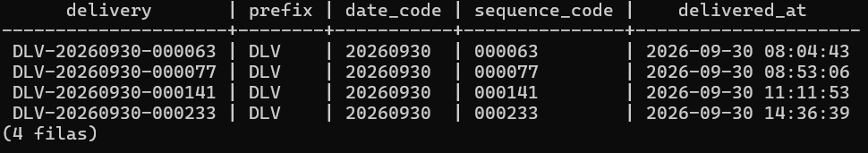

---

## Parte C: Operaciones de conjunto

### Ejercicio 7. `UNION` y `UNION ALL` - Directorio de contactos

#### Literal a) Directorio telefónico unificado

```sql
-- Exercise 07 - a
-- Unified contact directory for farmers in 54518 and collection points in Norte de Santander using UNION

SELECT 
    'farmer' AS contact_type,
    CONCAT(T1.first_name, ' ', T1.last_name) AS contact_name,
    T1.phone_number AS phone
FROM farm.farmers T1
WHERE T1.municipality_code = '54518'
  AND T1.phone_number IS NOT NULL

UNION

SELECT 
    'collection_point' AS contact_type,
    T2.point_name AS contact_name,
    T2.phone_number AS phone
FROM buy.collection_points T2
INNER JOIN geo.municipalities T3 
    ON T2.municipality_code = T3.municipality_code
WHERE T3.department_code = '54'
  AND T2.phone_number IS NOT NULL

ORDER BY contact_type ASC, contact_name ASC;
```

**Evidencia de ejecución:**  
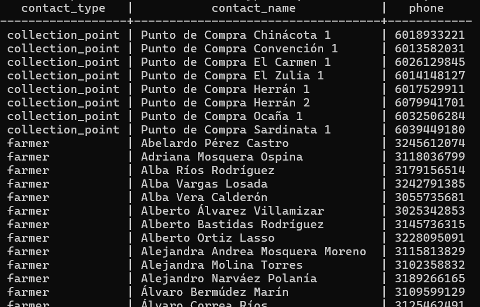

---

#### Literal b) Códigos de municipio con asociados o fincas (`UNION` vs. `UNION ALL`)

```sql
-- Exercise 07 - b
-- Municipality codes in Norte de Santander with farmers or farms using UNION vs UNION ALL

-- Query 1: UNION (no duplicates)
SELECT 
    T1.municipality_code AS municipality_code
FROM farm.farmers T1
INNER JOIN geo.municipalities T2 
    ON T1.municipality_code = T2.municipality_code
WHERE T2.department_code = '54'

UNION

SELECT 
    T3.municipality_code
FROM farm.farms T3
INNER JOIN geo.municipalities T4 
    ON T3.municipality_code = T4.municipality_code
WHERE T4.department_code = '54'

ORDER BY municipality_code;

-- Query 2: UNION ALL (preserving duplicates)
SELECT 
    T1.municipality_code AS municipality_code
FROM farm.farmers T1
INNER JOIN geo.municipalities T2 
    ON T1.municipality_code = T2.municipality_code
WHERE T2.department_code = '54'

UNION ALL

SELECT 
    T3.municipality_code
FROM farm.farms T3
INNER JOIN geo.municipalities T4 
    ON T3.municipality_code = T4.municipality_code
WHERE T4.department_code = '54'

ORDER BY municipality_code;
```

**Evidencia de ejecución:**  
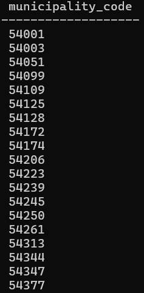
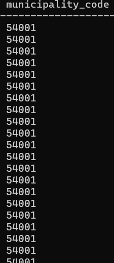

#### Comparación y diferencia de filas (Literal 7 b):
Al ejecutar la consulta utilizando `UNION`, el resultado devuelve un número menor de filas porque elimina automáticamente todos los registros duplicados cuando un municipio aparece tanto en la tabla de asociados como en la de fincas, mientras que la versión con `UNION ALL` conserva absolutamente todas las filas y repeticiones sin filtrar, arrojando un conteo mayor debido a que incluye cada coincidencia de manera independiente en ambos conjuntos.

---

### Ejercicio 8. `INTERSECT` y `EXCEPT` - Comparar conjuntos

#### Literal a) Municipios con fincas y punto de compra (`INTERSECT`)

```sql
-- Exercise 08 - a
-- Municipalities in Norte de Santander having both farms and collection points using INTERSECT

SELECT 
    T2.municipality_code AS municipality_code,
    T2.municipality_name AS municipality
FROM farm.farms T1
INNER JOIN geo.municipalities T2 
    ON T1.municipality_code = T2.municipality_code
WHERE T2.department_code = '54'

INTERSECT

SELECT 
    T4.municipality_code,
    T4.municipality_name
FROM buy.collection_points T3
INNER JOIN geo.municipalities T4 
    ON T3.municipality_code = T4.municipality_code
WHERE T4.department_code = '54'

ORDER BY municipality;
```

**Evidencia de ejecución:**  
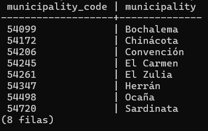

---

#### Literal b) Municipios con fincas pero sin punto de compra (`EXCEPT`)

```sql
-- Exercise 08 - b
-- Municipalities in Norte de Santander having farms but no collection points using EXCEPT

SELECT 
    T2.municipality_code AS municipality_code,
    T2.municipality_name AS municipality
FROM farm.farms T1
INNER JOIN geo.municipalities T2 
    ON T1.municipality_code = T2.municipality_code
WHERE T2.department_code = '54'

EXCEPT

SELECT 
    T4.municipality_code,
    T4.municipality_name
FROM buy.collection_points T3
INNER JOIN geo.municipalities T4 
    ON T3.municipality_code = T4.municipality_code
WHERE T4.department_code = '54'

ORDER BY municipality;
```

**Evidencia de ejecución:**  
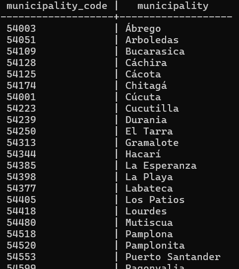

---

#### Literal c) Fincas de Pamplona con entregas en 2025 pero no en 2026 (`EXCEPT`)

```sql
-- Exercise 08 - c
-- Farms in municipality 54518 that delivered coffee in 2025 but not in 2026 using EXCEPT

SELECT 
    T1.farm_name AS farm,
    T1.rural_district AS rural_district
FROM farm.farms T1
INNER JOIN buy.deliveries T2 
    ON T1.farm_id = T2.farm_id
WHERE T1.municipality_code = '54518'
  AND EXTRACT(year FROM T2.delivered_at) = 2025

EXCEPT

SELECT 
    T3.farm_name,
    T3.rural_district
FROM farm.farms T3
INNER JOIN buy.deliveries T4 
    ON T3.farm_id = T4.farm_id
WHERE T3.municipality_code = '54518'
  AND EXTRACT(year FROM T4.delivered_at) = 2026

ORDER BY farm ASC, rural_district ASC;
```

**Evidencia de ejecución:**  
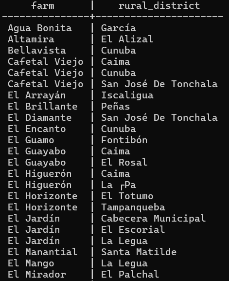

#### Explicación sobre la inversión del orden en `EXCEPT` (Literal 8 c):
Si se invierte el orden de las consultas en el operador `EXCEPT`, la lógica cambia por completo: en lugar de mostrar las fincas que entregaron café en 2025 pero que no lo hicieron en 2026, la consulta arrojaría las fincas que entregaron café en 2026 pero que no tuvieron entregas en 2025, alterando el conjunto base evaluado y reflejando un filtro opuesto orientado a identificar nuevos productores o reactivaciones en lugar de deserciones.

---

## Parte D: Funciones definidas por el usuario (PL/pgSQL)

### Ejercicio 9. `CREATE FUNCTION` - Encapsular lógica reutilizable

#### Literal a) Función `buy.fn_count_deliveries`

```sql
-- Exercise 09 - a
-- Function buy.fn_count_deliveries and test for 'Punto de Compra Bochalema 1' on September 30, 2026

CREATE OR REPLACE FUNCTION buy.fn_count_deliveries(
    p_point_name VARCHAR,
    p_date DATE
)
RETURNS INT
LANGUAGE plpgsql
AS $$
DECLARE
    v_total INT;
BEGIN
    SELECT COUNT(T1.delivery_id)
    INTO v_total
    FROM buy.deliveries T1
    INNER JOIN buy.collection_points T2 
        ON T1.collection_point_id = T2.collection_point_id
    WHERE T2.point_name = p_point_name
      AND T1.delivered_at::DATE = p_date;

    RETURN v_total;
END;
$$;

SELECT 
    buy.fn_count_deliveries('Punto de Compra Bochalema 1', DATE '2026-09-30') AS deliveries_count;
```

**Evidencia de ejecución:**  
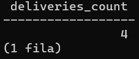

---

#### Literal b) Función `farm.fn_age_years` aplicada al top 10 asociados más jóvenes al afiliarse

```sql
-- Exercise 09 - b
-- Function farm.fn_age_years and top 10 farmers in 54518 who joined at the youngest age

CREATE OR REPLACE FUNCTION farm.fn_age_years(
    p_birth_date DATE,
    p_reference_date DATE
)
RETURNS INT
LANGUAGE plpgsql
AS $$
DECLARE
    v_years INT;
BEGIN
    v_years := DATE_PART('year', AGE(p_reference_date, p_birth_date))::INT;
    RETURN v_years;
END;
$$;

SELECT 
    T1.document_number AS document,
    T1.first_name AS first_name,
    T1.last_name AS last_name,
    farm.fn_age_years(T1.birth_date, DATE '2026-09-30') AS age_years,
    farm.fn_age_years(T1.birth_date, T1.membership_date) AS age_at_membership
FROM farm.farmers T1
WHERE T1.municipality_code = '54518'
ORDER BY age_at_membership
LIMIT 10;
```

**Evidencia de ejecución:**  
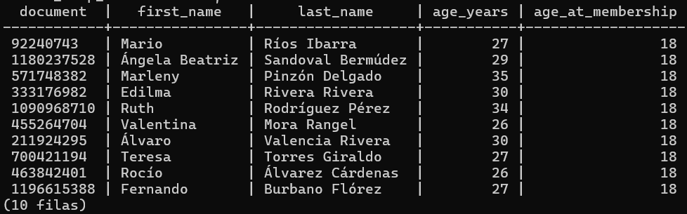

---

#### Literal c) Función `farm.fn_short_name` para asociados hombres de 54518

```sql
-- Exercise 09 - c
-- Function farm.fn_short_name and list of male farmers in municipality 54518

CREATE OR REPLACE FUNCTION farm.fn_short_name(
    p_first_name VARCHAR,
    p_last_name VARCHAR
)
RETURNS VARCHAR
LANGUAGE plpgsql
AS $$
DECLARE
    v_short_name VARCHAR;
BEGIN
    v_short_name := CONCAT(UPPER(SUBSTRING(p_first_name FROM 1 FOR 1)), '. ', p_last_name);
    RETURN v_short_name;
END;
$$;

SELECT 
    farm.fn_short_name(T1.first_name, T1.last_name) AS short_name,
    T1.phone_number AS phone
FROM farm.farmers T1
WHERE T1.municipality_code = '54518'
  AND T1.gender = 'M'
ORDER BY T1.last_name ASC, T1.first_name ASC;
```

**Evidencia de ejecución:**  
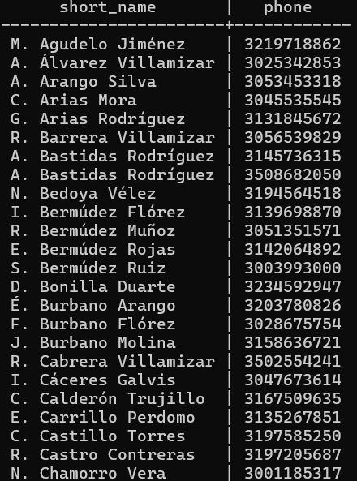

---

### Ejercicio 10. Integrador - Saldo pendiente de las liquidaciones

#### Literal a) Función `pay.fn_settlement_balance`

```sql
-- Exercise 10 - a
-- Function pay.fn_settlement_balance and test for settlement 'STL-20261001-000040'

CREATE OR REPLACE FUNCTION pay.fn_settlement_balance(
    p_settlement_id VARCHAR
)
RETURNS NUMERIC
LANGUAGE plpgsql
AS $$
DECLARE
    v_net NUMERIC;
    v_paid NUMERIC;
BEGIN
    SELECT T1.net_amount
    INTO v_net
    FROM pay.settlements T1
    WHERE T1.settlement_id = p_settlement_id;

    SELECT SUM(T2.amount)
    INTO v_paid
    FROM pay.payments T2
    WHERE T2.settlement_id = p_settlement_id;

    RETURN v_net - COALESCE(v_paid, 0);
END;
$$;

SELECT 
    pay.fn_settlement_balance('STL-20261001-000040') AS balance_cop;
```

**Evidencia de ejecución:**  
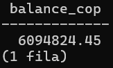

---

#### Literal b) Liquidaciones no anuladas del 30 de septiembre de 2026 con saldo > 0

```sql
-- Exercise 10 - b
-- Non-cancelled settlements for deliveries on September 30, 2026 with balance > 0, ordered descending

SELECT 
    T1.settlement_id AS settlement,
    T1.delivery_id AS delivery,
    T1.status AS settlement_status,
    T1.net_amount AS net_cop,
    pay.fn_settlement_balance(T1.settlement_id) AS balance_cop
FROM pay.settlements T1
INNER JOIN buy.deliveries T2 
    ON T1.delivery_id = T2.delivery_id
WHERE T2.delivered_at::DATE = DATE '2026-09-30'
  AND T1.status <> 'cancelled'
  AND pay.fn_settlement_balance(T1.settlement_id) > 0
ORDER BY balance_cop DESC;
```

**Evidencia de ejecución:**  
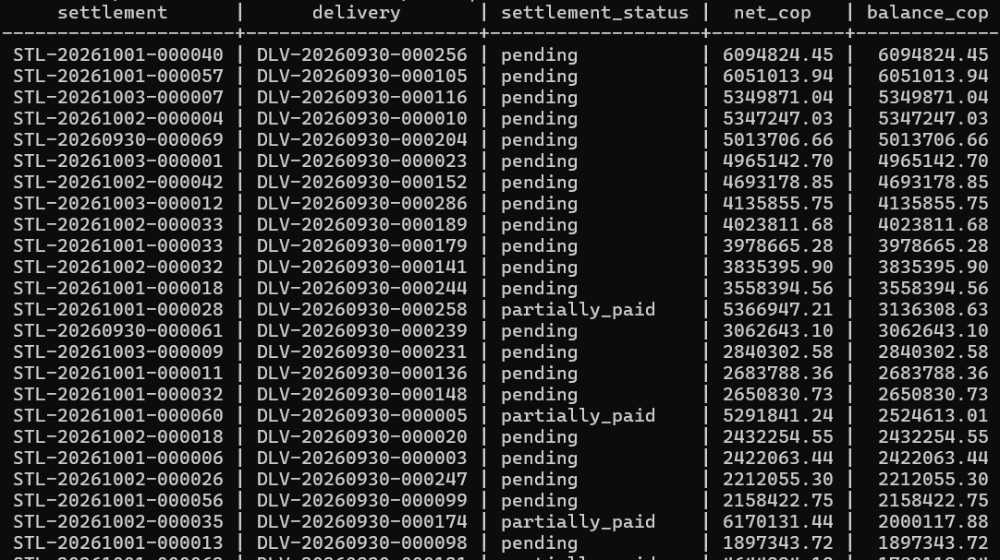

---

#### Literal c) Saldo total pendiente por punto de compra al 30 de septiembre de 2026

```sql
-- Exercise 10 - c
-- Summary by collection point for deliveries on September 30, 2026 with total balance > 0 (3 tables)

SELECT 
    T3.point_name AS collection_point,
    COUNT(T1.settlement_id) AS settlements_count,
    SUM(pay.fn_settlement_balance(T1.settlement_id)) AS total_balance_cop
FROM pay.settlements T1
INNER JOIN buy.deliveries T2 
    ON T1.delivery_id = T2.delivery_id
INNER JOIN buy.collection_points T3 
    ON T2.collection_point_id = T3.collection_point_id
WHERE T2.delivered_at::DATE = DATE '2026-09-30'
  AND T1.status <> 'cancelled'
GROUP BY T3.point_name
HAVING SUM(pay.fn_settlement_balance(T1.settlement_id)) > 0
ORDER BY total_balance_cop DESC;
```

**Evidencia de ejecución:**  
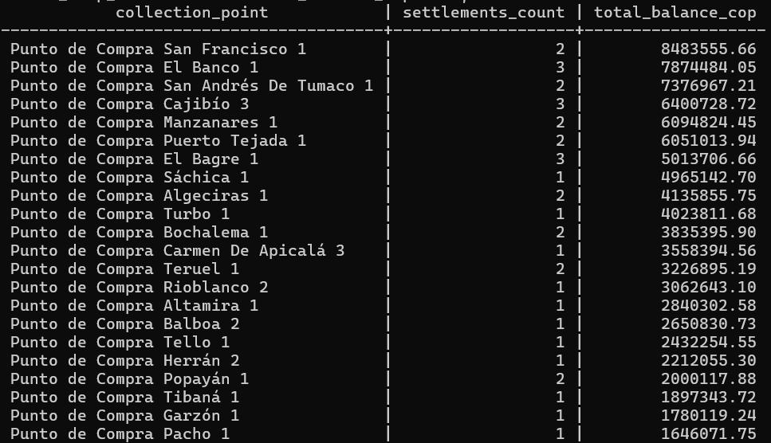

#### Explicación sobre `COALESCE` y `CREATE OR REPLACE FUNCTION` (Ejercicio 10):
Si no se empleara la función `COALESCE`, cualquier cálculo sobre una liquidación sin pagos registrados arrojaría un valor nulo (`NULL`) en la suma, lo que provocaría que la operación aritmética de resta devuelva un saldo vacío en lugar de reflejar correctamente el monto neto total de la liquidación; por otro lado, ejecutar dos veces la instrucción `CREATE OR REPLACE FUNCTION` simplemente sobreescribe y actualiza la definición existente de la función en el catálogo de la base de datos de manera limpia y segura, evitando generar errores por duplicidad de objetos.